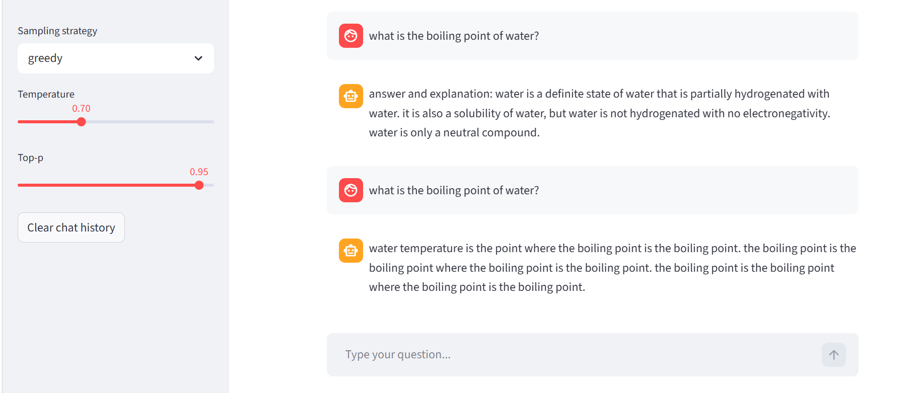
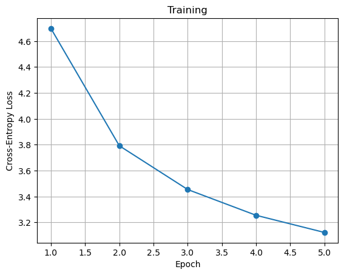

# Transformers from Scratch in PyTorch

Two transformer models implemented in PyTorch, built up from the components:

1. **Encoder-only transformer** for sentiment classification of IMDb movie reviews. It uses a hand-written multi-head scaled dot-product attention.
2. **Decoder-only (GPT-style) language model**, about 36 M parameters, trained on question–answer pairs from GooAQ. It has greedy and nucleus (top-p) sampling and a small Streamlit chat interface.

<p align="center">
  
</p>

## 1. Encoder: sentiment classification

[`01_encoder_sentiment_classifier/imdb_sentiment_encoder.ipynb`](01_encoder_sentiment_classifier/imdb_sentiment_encoder.ipynb)

* Text cleaning, a word-level tokenizer (10k vocabulary, `[PAD]`/`[UNK]`/`[CLS]`) and padding/truncation to 256 tokens.
* **Multi-head attention implemented manually**: Q/K/V projections, scaled dot-product, key-padding masks and head concatenation.
* Pre-LayerNorm encoder blocks with residual connections, sinusoidal positional encoding and a `[CLS]`-token classification head.
* Model size: 3 layers, 4 heads, d<sub>model</sub> = 96. Trained with AdamW for 3 epochs.

| Split | Accuracy |
|---|---|
| Train (epoch 3) | 87.9 % |
| Validation | 85.6 % |
| **Test (20k reviews)** | **84.5 %** |

## 2. Decoder: question-answering language model

[`02_decoder_chatbot/`](02_decoder_chatbot)

| File | Content |
|---|---|
| `tokenizer.py` | Byte-level BPE tokenizer (20k vocabulary) trained on the corpus |
| `dataset.py` | Builds `question [SEP] answer [END]` sequences with shifted targets and padding masks |
| `model.py` | Decoder blocks (pre-LN, causal self-attention, GELU MLP), sinusoidal positional encoding, causal mask |
| `train.py` | AdamW, mixed-precision training on GPU, checkpointing |
| `inference.py` | Greedy decoding and **top-p sampling with temperature** |
| `chatbot.py` | Streamlit chat UI |

Configuration: 5 layers, 8 heads, d<sub>model</sub> = 512, context length 128, about 36 M parameters. Trained for 5 epochs on GPU, with cross-entropy falling from 4.70 to 3.12:

<p align="center"></p>

The model produces fluent English but is often factually wrong or repetitive, especially with greedy decoding (see the screenshot above). This is expected for a small model trained from scratch, and it shows clearly why top-p sampling matters.

## Running

```bash
pip install -r requirements.txt
cd 02_decoder_chatbot
python tokenizer.py          # train tokenizer  -> temp/tokenizer.json
python train.py              # train model      -> temp/model.pth  (GPU recommended)
python inference.py          # sample answers
streamlit run chatbot.py     # chat UI
```

The datasets (IMDb and a GooAQ subset, in Hugging Face `datasets` format) and trained weights (~145 MB) are not included in the repository.

## Reference

Vaswani et al. (2017). *Attention Is All You Need.* NeurIPS. [arXiv:1706.03762](https://arxiv.org/abs/1706.03762)

---
*Project in INF265 – Deep Learning, University of Bergen (spring 2026). The project framework (configuration, training loop and Streamlit skeleton) was provided by the course. The model architecture, attention, data pipeline and sampling are my own implementation.*
